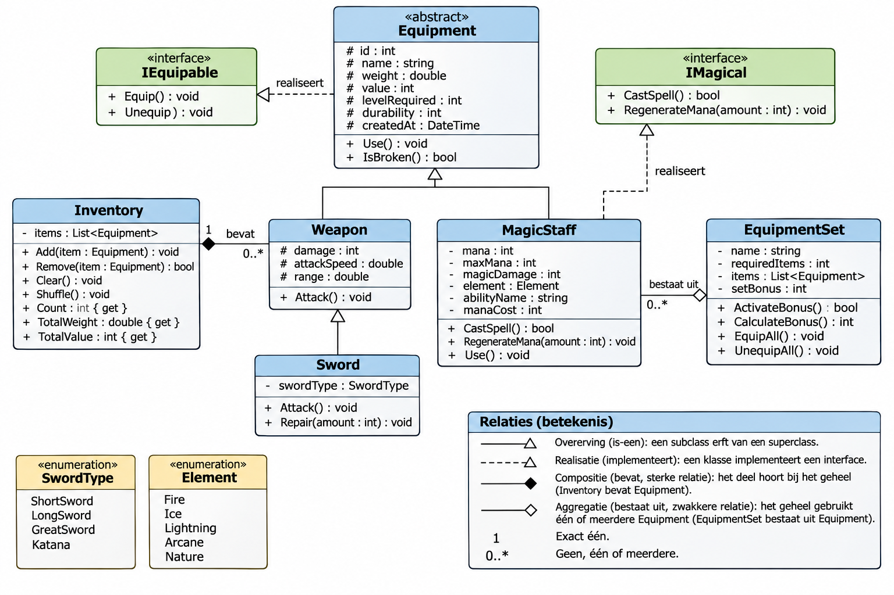

# RPG Item & Equipment System — Objectgeoriënteerd programmeren



*Het volledige klassendiagram wordt opgebouwd tot en met opdracht 6 — EquipmentSet.*

**Software Development · MBO niveau 4 · C# / .NET 10**

## Situatie

Je ontwikkelt een herbruikbare C#-bibliotheek voor een RPG. Je begint met een enkel wapen, bouwt een inventory en maakt daarna verschillende soorten equipment, magische abilities en een equipmentset. Je test alles vanuit een Console App. Je bouwt **geen volledige game**.

## Leerdoelen

Je leert klassen en objecten, private en protected fields, enums, constructor- en method-overloading, methods, read-only en write-only properties, `TimeSpan`, `DateTime`, `List<T>`, berekende properties, `static readonly`, abstracte klassen, overerving, overriding, interfaces, compositie en testen.

## Benodigdheden

.NET 10 SDK, Visual Studio / Rider / VS Code, Git en GitHub.

## Opdrachten

| Nr. | Opdracht | Onderwerp |
|---|---|---|
| 0 | [Een RPG-item beschrijven](opdrachten/00-rpg-item.md) | Klasse, object en datatypes |
| 1 | [Weapon](opdrachten/01-weapon.md) | Fields, enum, constructors, methods en properties |
| 2 | [Inventory](opdrachten/02-inventory.md) | `List<Weapon>`, berekeningen, shuffle |
| 3 | [Equipment](opdrachten/03-equipment.md) | Abstract, protected, static readonly, overloading en refactoring |
| 4 | [Sword](opdrachten/04-sword.md) | Overerving, enum, overriding |
| 5 | [MagicStaff](opdrachten/05-magicstaff.md) | Interface, readonly, status, berekeningen |
| 6 | [EquipmentSet](opdrachten/06-equipmentset.md) | Twee interfaces, compositie, null-checks |

## Zo werk je

1. Lees de situatie, leerdoelen en theorie.
2. Werk de stappen in volgorde uit. Schrijf de gevraagde code zelf.
3. Voer de testscenario's uit en controleer de verwachte resultaten.
4. Commit je wijzigingen na iedere opdracht en push ze naar GitHub.

## Projectstructuur

```text
RpgEquipmentSystem/
├── RpgEquipment/                # Class Library
│   ├── Weapons/                 # Weapon, Inventory, Sword, MagicStaff
│   ├── Equipment/               # Equipment, EquipmentSet
│   └── Interfaces/              # IMagic, IEquipable, ISetBonus
└── Tester/                      # Console App met Program.cs
```

De mappen ontstaan tijdens de opdrachten. In opdracht 3 verplaats je gedeelde eigenschappen van `Weapon` naar de abstracte klasse `Equipment`. Dat is een bewuste refactoring: je eerdere code blijft bruikbaar.

**Begin:** [Opdracht 0](opdrachten/00-rpg-item.md) of [Opdracht 1](opdrachten/01-weapon.md) als je de introductie al hebt gedaan.
